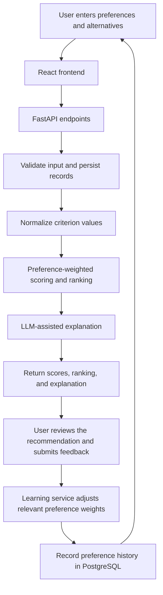

# Decision OS

An AI-assisted decision engine. Tell it what you're deciding between,
teach it what matters to you, and it scores the options, explains its
reasoning, and gets better over time from your feedback.

## Structure

```
decision-os/
├── backend/     FastAPI service — API, scoring engine, LLM integration
├── frontend/    Streamlit app — profile, decisions, history, insights
├── data/        Sample/seed data
└── docs/        Architecture and design notes
```

See [`docs/architecture.md`](docs/architecture.md) for a system overview and
[`docs/decision_engine.md`](docs/decision_engine.md) for how scoring and
learning work.

## Quickstart

### 1. Backend

```bash
cd backend
python -m venv .venv && source .venv/bin/activate   # Windows: .venv\Scripts\activate
pip install -r requirements.txt
cp .env.example .env   # then fill in DATABASE_URL / API keys
uvicorn app.main:app --reload
```

The API will be available at `http://localhost:8000`, with interactive
docs at `http://localhost:8000/docs`.

### 2. Frontend

```bash
cd frontend
pip install streamlit pandas requests
streamlit run app.py
```

The app will be available at `http://localhost:8501`.

### 3. Both, via Docker Compose

```bash
docker-compose up --build
```

## Running tests

```bash
cd backend
pytest
```

## Tech stack

- **Backend:** FastAPI, SQLAlchemy, Pydantic, Alembic
- **Frontend:** Streamlit
- **AI:** OpenAI / Google Gemini / Groq (pluggable provider layer)
- **Database:** PostgreSQL


<div align="center">

# DecisionOS

### Personal AI Decision Engine

Compare alternatives against your own priorities, understand the trade-offs, and refine your preferences with feedback.


</div>

---

## Overview

DecisionOS is an AI-assisted decision-support application. It combines **transparent, preference-weighted scoring** with **LLM-generated explanations**, so recommendations are never based on an AI response alone.

> **Project status:** Working MVP / portfolio project. It is built to support human decision-making, not to make consequential decisions autonomously.

### The problem

Many everyday choices involve competing priorities. One person values cost, another values performance, reliability, or convenience. A generic recommendation misses those differences, and an AI answer is hard to audit when its reasoning is unclear.

### The approach

| Layer | Purpose |
|---|---|
| **Preference profile** | Represents what matters to the user (weights and direction) |
| **Scoring and ranking** | Compares alternatives consistently, in application code |
| **Explanation layer** | Communicates why an option fits the stated preferences |
| **Feedback loop** | Makes small, traceable adjustments to preference weights over time |

---

## Table of Contents

- [Features](#features)
- [Use Cases](#use-cases)
- [How It Works](#how-it-works)
- [Architecture](#architecture)
- [Design Decisions](#design-decisions)
- [Getting Started](#getting-started)
- [API Reference](#api-reference)
- [Testing](#testing)
- [Limitations and Responsible Use](#limitations-and-responsible-use)
- [Roadmap](#roadmap)
- [Author](#author)

---

## Features

- **Preference management:** set criterion weights and choose whether each criterion is maximized or minimized
- **Decision and option management:** create decisions and compare alternatives by their attributes
- **Preference-based scoring:** normalize criterion values and apply weights to produce comparable scores and rankings
- **AI-assisted explanations:** natural-language explanations of recommendations and trade-offs via supported LLM providers
- **Provider fallback:** modular provider integration that can attempt another configured provider when one is unavailable
- **Feedback-driven learning:** criterion-importance feedback incrementally adjusts preference weights
- **History and analytics:** decisions, feedback, preference changes, and learning history are persisted for inspection
- **REST API:** FastAPI endpoints with interactive documentation
- **Automated tests:** coverage of API, scoring, provider, and learning behavior

---

## Use Cases

| Category | Example criteria |
|---|---|
| **Products** | Price, performance, battery life, reliability |
| **Courses** | Fees, duration, curriculum, format, career relevance |
| **Job opportunities** | Compensation, location, learning opportunities, work arrangement, role fit |
| **Services or plans** | Price, included features, quality, convenience |

> These are example use cases. Comparison quality depends on the options, attributes, and preferences you enter. DecisionOS does not verify listings against external sources.

---

## How It Works



### 1. Capture preferences and alternatives
The user creates a decision, adds options, and defines or selects criteria such as price, performance, or battery life. Each preference has a **weight** and a **direction**: a lower price may be better, while higher performance may be better.

### 2. Score alternatives
The backend validates the request, and the scoring services normalize criterion values so different scales can be compared. Preference weights then determine each option's overall score and ranking. Results depend on the supplied data, normalization rules, directions, and weights.

### 3. Explain the result
The AI layer generates a natural-language explanation of the recommendation and trade-offs. The two layers have distinct roles: scoring provides a consistent, inspectable basis for comparison, while the LLM makes the result easier to understand. An explanation is not proof that the underlying data is correct.

### 4. Learn from feedback
After reviewing a decision, the user gives an overall satisfaction rating and separate importance ratings for individual criteria.

| Criterion-importance rating | Effect on that criterion's weight |
|---|---|
| 1 — Not important | Decrease |
| 2 — Slightly important | Decrease |
| 3 — Moderately important | No change |
| 4 — Very important | Increase |
| 5 — Extremely important | Increase |

The learning service uses a small fixed step (`0.05`) and clamps weights to `0.0–1.0`. This is a lightweight heuristic, not a model trained on a large dataset. The overall satisfaction rating is stored as feedback; criterion-importance ratings drive the weight adjustment.

---

## Architecture

| Layer | Technologies | Responsibility |
|---|---|---|
| **Frontend** | React, Vite, JavaScript, CSS | UI, forms, decision results, feedback, analytics, and history views |
| **Backend API** | Python, FastAPI, Pydantic | Request validation and HTTP endpoints |
| **Application services** | Python, SQLAlchemy | Scoring, ranking, explanations, preference updates, business logic |
| **Database** | PostgreSQL | Users, preferences, decisions, options, scores, feedback, preference history |
| **LLM integrations** | OpenAI, Gemini, Groq, mock provider (dev/testing) | AI explanations, provider integration and fallback |
| **Testing** | pytest | Automated backend tests |

### Repository structure

```text
DecisionOS-personal-AI-decision-engine/
├── backend/
│   ├── app/
│   │   ├── ai/          # LLM services, provider adapters, and fallback logic
│   │   ├── api/         # FastAPI routes
│   │   ├── core/        # Configuration and core utilities
│   │   ├── database/    # Database connection and schema notes
│   │   ├── models/      # SQLAlchemy models
│   │   ├── schemas/     # Request and response schemas
│   │   └── services/    # Decision, scoring, feedback, and learning logic
│   ├── tests/           # Backend tests
│   └── requirements.txt
├── frontend/
│   ├── src/             # React/Vite application
│   ├── package.json
│   └── vite.config.js
├── data/sample_data/    # Example decision input
├── docs/                # Architecture and decision-engine notes
├── .env.example         # Environment-variable template
├── docker-compose.yml
└── README.md
```

---

## Design Decisions

**Transparent scoring plus AI explanations.** Scoring and ranking live in application code, which makes the numeric comparison easier to test and inspect. The LLM explains the result; it is not the sole source of the ranking.

**Separate frontend and backend.** React/Vite handles presentation and FastAPI exposes the logic through endpoints. Each side can be developed and tested independently, and decision logic stays out of UI components.

**PostgreSQL for relational data.** Decisions connect to options, scores, feedback, preferences, and preference-history entries. PostgreSQL provides durable storage and preserves a record of how preferences change.

**Provider adapters and fallback.** LLM calls are isolated behind provider-specific modules, giving one place to handle configuration and fallback. Fallback improves resilience but cannot guarantee a provider is always available.

**Incremental learning over a training pipeline.** A small, explainable weight-update rule is easier to validate than a custom model that needs a large labeled dataset. It demonstrates the feedback loop without claiming to have learned a user's complete preferences.

**Tests and database constraints.** Automated tests catch regressions in scoring, APIs, and learning. Feedback is limited to one record per decision at the database level, so repeated submissions cannot repeatedly influence preferences.

---

## Getting Started

### Prerequisites

- Python 3.11 (recommended)
- Node.js and npm
- A running PostgreSQL instance
- API key(s) for the live LLM provider(s) you want to use

### 1. Clone the repository

```bash
git clone https://github.com/Ilavarasan-v/DecisionOS-personal-AI-decision-engine.git
cd DecisionOS-personal-AI-decision-engine
```

### 2. Set up the backend

**Windows PowerShell**

```powershell
python -m venv .venv
.\.venv\Scripts\Activate.ps1
pip install -r backend/requirements.txt
Copy-Item .env.example .env
```

Edit the root `.env` file:

- Set `DATABASE_URL` to your PostgreSQL connection string.
- Add the API keys for the providers you intend to use.
- Initialize the database schema following the repository's database setup notes.

> **Security:** never commit `.env` or place secret keys in frontend variables.

Start the API from the repository root:

```powershell
uvicorn backend.app.main:app --reload
```

### 3. Set up the frontend

In a second terminal:

```powershell
cd frontend
npm install
npm run dev
```

Open the URL printed by Vite (usually `http://localhost:5173`). If you change the backend host or port, update the frontend API configuration to match.

---

## API Reference

| Resource | URL |
|---|---|
| Health check | `http://127.0.0.1:8000/health` |
| Interactive API docs | `http://127.0.0.1:8000/docs` |
| API base path | `http://127.0.0.1:8000/api/v1` |

---

## Testing

Run the backend suite from the repository root with the virtual environment active:

```powershell
pytest -q
```

The project had **55 passing tests** during initial release preparation. Re-run them against your checkout to verify its current state.

Verify the frontend production build:

```powershell
cd frontend
npm run build
```

---

## Limitations and Responsible Use

- **Input quality matters.** Missing, inaccurate, or incomparable attributes can produce misleading scores.
- **Normalization has assumptions.** Scales must be converted appropriately, and maximize/minimize directions must be set correctly.
- **Learning is heuristic.** Weights change by a fixed step based on stated importance. It is not a trained personalization model.
- **An explanation is not verification.** LLMs can be inaccurate or overconfident. Check the supplied attributes and the score breakdown before relying on a recommendation.
- **Provider dependencies remain.** Live AI features depend on API keys, connectivity, rate limits, availability, and cost. Fallback does not remove these constraints.
- **Feedback is limited.** One feedback record per decision; editing or multiple rounds would need an explicit versioning policy.
- **MVP, not production-hardened.** Before real-user deployment, review authentication and authorization, user-data isolation, secrets handling, request throttling, migrations, logging, monitoring, backups, and deployment configuration.
- **Not for high-stakes decisions.** Do not use DecisionOS as the sole basis for medical, legal, financial, hiring, or other consequential decisions. The user remains responsible for validating information and making the final choice.

---

## Roadmap

- [ ] Versioned, repeatable database migrations and CI checks
- [ ] Better validation and normalization for additional criterion types and missing data
- [ ] Controlled evaluation of learning behavior with before/after examples
- [ ] Feedback correction and multiple feedback rounds with a clear history policy
- [ ] API security, deployment hardening, and observability
- [ ] Screenshots or a hosted demo

---

## Author

**Ilavarasan V** — built as an individual AI engineering portfolio project exploring personalized decision support, explainable scoring, LLM integration, and feedback-driven preference updates.

[](https://github.com/Ilavarasan-v)
[](https://github.com/Ilavarasan-v/DecisionOS-personal-AI-decision-engine)
